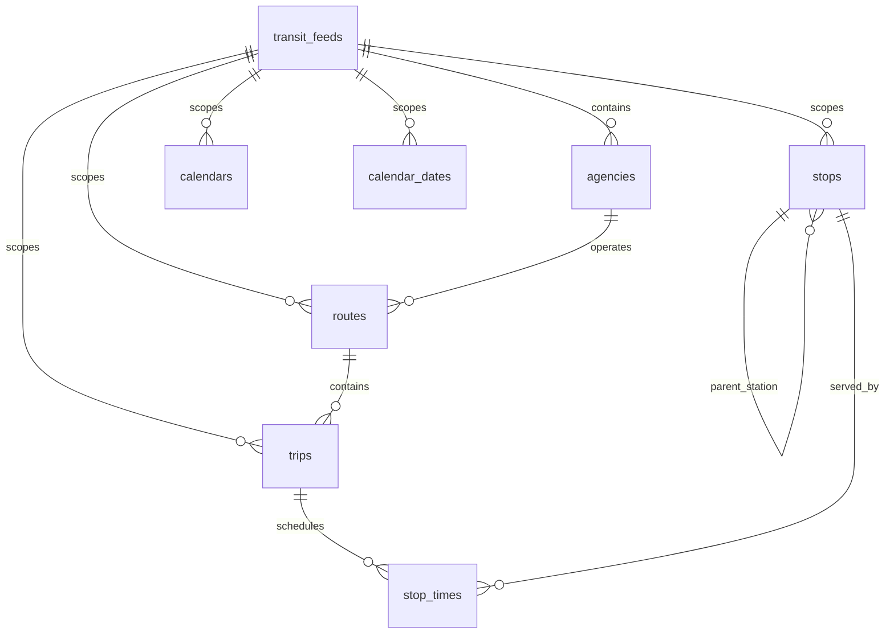

# WaitWatch — Database Design & Transit Data Models

This document defines the database architecture, schema definitions, constraints, indexes, and relationships established in **Stage 1, Slice 1.1**.

## 1. Overview & Multi-City Architecture

WaitWatch is designed to support multiple transit systems and cities concurrently. To achieve this without entity collisions, all transit data is scoped under a parent feed configuration (`transit_feeds`).

Standard GTFS identifiers (`agency_id`, `route_id`, `stop_id`, `trip_id`, `service_id`) are unique only within their respective transit feed or agency. The schema enforces composite uniqueness constraints (e.g., `(feed_id, route_id)`) to prevent cross-feed collisions while preserving the agency's original GTFS identifiers.



---

## 2. Table Specifications

### 2.1 `transit_feeds`
Stores configuration, feed URLs, and operational state for each tracked city or transit system.

| Column | Type | Constraints | Description |
|---|---|---|---|
| `id` | `INTEGER` | PRIMARY KEY, AUTOINCREMENT | Internal synthetic identifier |
| `city_name` | `VARCHAR(100)` | NOT NULL | Human-readable city name (e.g., "Delhi") |
| `slug` | `VARCHAR(64)` | NOT NULL, UNIQUE, INDEX | URL-safe slug (e.g., "delhi-dtc") |
| `static_gtfs_url` | `VARCHAR(2048)` | NOT NULL | HTTP URL to the static GTFS zip bundle |
| `realtime_vehicle_positions_url` | `VARCHAR(2048)` | NULLABLE | GTFS-RT VehiclePositions endpoint URL |
| `realtime_trip_updates_url` | `VARCHAR(2048)` | NULLABLE | GTFS-RT TripUpdates endpoint URL |
| `realtime_alerts_url` | `VARCHAR(2048)` | NULLABLE | GTFS-RT ServiceAlerts endpoint URL |
| `api_key_env_var` | `VARCHAR(100)` | NULLABLE | Reference name of the env var storing the API key |
| `feed_status` | `VARCHAR(32)` | NOT NULL, DEFAULT 'active' | Operational status: active, inactive, maintenance |
| `is_live_tracking_enabled` | `BOOLEAN` | NOT NULL, DEFAULT FALSE | Whether realtime vehicle polling is enabled |
| `last_static_import_at` | `TIMESTAMP WITH TZ` | NULLABLE | Timestamp of last successful static GTFS ingestion |
| `last_realtime_poll_at` | `TIMESTAMP WITH TZ` | NULLABLE | Timestamp of last successful GTFS-RT polling |
| `created_at` | `TIMESTAMP WITH TZ` | NOT NULL, DEFAULT now() | Creation timestamp |
| `updated_at` | `TIMESTAMP WITH TZ` | NOT NULL, DEFAULT now() | Last update timestamp |

---

### 2.2 `agencies`
Stores transit agency information parsed from GTFS `agency.txt`.

| Column | Type | Constraints | Description |
|---|---|---|---|
| `id` | `INTEGER` | PRIMARY KEY, AUTOINCREMENT | Internal synthetic identifier |
| `feed_id` | `INTEGER` | FK (`transit_feeds.id` ON DELETE CASCADE), INDEX | Parent transit feed |
| `agency_id` | `VARCHAR(255)` | NULLABLE | Original GTFS agency ID (optional in single-agency feeds; altered in migration 0002) |
| `name` | `VARCHAR(255)` | NOT NULL | Full name of the transit agency |
| `url` | `VARCHAR(2048)` | NOT NULL | Official agency URL |
| `timezone` | `VARCHAR(100)` | NOT NULL | IANA timezone (e.g., "Asia/Kolkata") |
| `phone` | `VARCHAR(50)` | NULLABLE | Voice telephone number |
| `lang` | `VARCHAR(10)` | NULLABLE | Primary language code (e.g., "en", "hi") |
| `fare_url` | `VARCHAR(2048)` | NULLABLE | URL for fare information |
| `email` | `VARCHAR(255)` | NULLABLE | Customer service email address |
| `created_at` | `TIMESTAMP WITH TZ` | NOT NULL, DEFAULT now() | Creation timestamp |
| `updated_at` | `TIMESTAMP WITH TZ` | NOT NULL, DEFAULT now() | Last update timestamp |

**Constraints:**
- `UNIQUE (feed_id, agency_id)`

---

### 2.3 `routes`
Stores transit routes from GTFS `routes.txt`.

| Column | Type | Constraints | Description |
|---|---|---|---|
| `id` | `INTEGER` | PRIMARY KEY, AUTOINCREMENT | Internal synthetic identifier |
| `feed_id` | `INTEGER` | FK (`transit_feeds.id` ON DELETE CASCADE), INDEX | Parent transit feed |
| `agency_id` | `INTEGER` | FK (`agencies.id` ON DELETE CASCADE), INDEX | Operating agency |
| `route_id` | `VARCHAR(255)` | NOT NULL | Original GTFS route ID |
| `short_name` | `VARCHAR(100)` | NULLABLE | Short public route designation (e.g., "534") |
| `long_name` | `VARCHAR(255)` | NULLABLE | Full descriptive name |
| `description` | `VARCHAR(2048)` | NULLABLE | Detailed route description |
| `route_type` | `INTEGER` | NOT NULL | GTFS route type (0=tram, 1=subway, 3=bus, etc.) |
| `route_url` | `VARCHAR(2048)` | NULLABLE | URL of a web page about that particular route |
| `route_color` | `VARCHAR(7)` | NULLABLE | 6-character hex color (e.g., "0072BC") |
| `text_color` | `VARCHAR(7)` | NULLABLE | 6-character hex color for text |
| `sort_order` | `INTEGER` | NULLABLE | Ordering index for UI presentation |
| `created_at` | `TIMESTAMP WITH TZ` | NOT NULL, DEFAULT now() | Creation timestamp |
| `updated_at` | `TIMESTAMP WITH TZ` | NOT NULL, DEFAULT now() | Last update timestamp |

**Constraints & Indexes:**
- `UNIQUE (feed_id, route_id)`
- `INDEX (feed_id, route_type)`

---

### 2.4 `stops`
Stores stops, stations, and platforms from GTFS `stops.txt` with geospatial support.

| Column | Type | Constraints | Description |
|---|---|---|---|
| `id` | `INTEGER` | PRIMARY KEY, AUTOINCREMENT | Internal synthetic identifier |
| `feed_id` | `INTEGER` | FK (`transit_feeds.id` ON DELETE CASCADE), INDEX | Parent transit feed |
| `stop_id` | `VARCHAR(255)` | NOT NULL | Original GTFS stop ID |
| `code` | `VARCHAR(100)` | NULLABLE | Short passenger-facing code |
| `name` | `VARCHAR(255)` | NOT NULL | Name of the stop/station |
| `description` | `VARCHAR(2048)` | NULLABLE | Useful description of the stop |
| `latitude` | `FLOAT` | NOT NULL | WGS84 latitude coordinate |
| `longitude` | `FLOAT` | NOT NULL | WGS84 longitude coordinate |
| `point` | `geography(POINT, 4326)` | NULLABLE, GiST INDEX | PostGIS spatial point for proximity queries |
| `parent_station_id` | `INTEGER` | FK (`stops.id` ON DELETE SET NULL), INDEX | Parent station reference |
| `location_type` | `INTEGER` | NOT NULL, DEFAULT 0 | 0=stop, 1=station, 2=entrance/exit, etc. |
| `wheelchair_boarding` | `INTEGER` | NOT NULL, DEFAULT 0 | 0=no info, 1=accessible, 2=inaccessible |
| `platform_code` | `VARCHAR(50)` | NULLABLE | Platform identifier (e.g., "1", "A") |
| `timezone` | `VARCHAR(100)` | NULLABLE | Stop-specific timezone if different from agency |
| `created_at` | `TIMESTAMP WITH TZ` | NOT NULL, DEFAULT now() | Creation timestamp |
| `updated_at` | `TIMESTAMP WITH TZ` | NOT NULL, DEFAULT now() | Last update timestamp |

**Constraints & Indexes:**
- `UNIQUE (feed_id, stop_id)`
- `INDEX (feed_id, name)`
- `INDEX (point) USING gist` (PostgreSQL/PostGIS)

---

### 2.5 `trips`
Stores individual trips from GTFS `trips.txt`.

| Column | Type | Constraints | Description |
|---|---|---|---|
| `id` | `INTEGER` | PRIMARY KEY, AUTOINCREMENT | Internal synthetic identifier |
| `feed_id` | `INTEGER` | FK (`transit_feeds.id` ON DELETE CASCADE), INDEX | Parent transit feed |
| `route_id` | `INTEGER` | FK (`routes.id` ON DELETE CASCADE), INDEX | Route this trip belongs to |
| `service_id` | `VARCHAR(255)` | NOT NULL, INDEX | Calendar service schedule ID |
| `trip_id` | `VARCHAR(255)` | NOT NULL | Original GTFS trip ID |
| `trip_headsign` | `VARCHAR(255)` | NULLABLE | Destination sign displayed to riders |
| `trip_short_name` | `VARCHAR(100)` | NULLABLE | Public-facing trip identifier |
| `direction_id` | `INTEGER` | NULLABLE | 0 for outbound, 1 for inbound travel |
| `block_id` | `VARCHAR(255)` | NULLABLE | Block identifier for interlining |
| `shape_id` | `VARCHAR(255)` | NULLABLE, INDEX | Shape geometry identifier |
| `wheelchair_accessible` | `INTEGER` | NOT NULL, DEFAULT 0 | Accessibility indicator |
| `bikes_allowed` | `INTEGER` | NOT NULL, DEFAULT 0 | Bicycle policy indicator |
| `created_at` | `TIMESTAMP WITH TZ` | NOT NULL, DEFAULT now() | Creation timestamp |
| `updated_at` | `TIMESTAMP WITH TZ` | NOT NULL, DEFAULT now() | Last update timestamp |

**Constraints & Indexes:**
- `UNIQUE (feed_id, trip_id)`
- `INDEX (feed_id, service_id)`
- `INDEX (feed_id, shape_id)`

---

### 2.6 `stop_times`
Stores scheduled arrival and departure times from GTFS `stop_times.txt`.

| Column | Type | Constraints | Description |
|---|---|---|---|
| `id` | `INTEGER` | PRIMARY KEY, AUTOINCREMENT | Internal synthetic identifier |
| `feed_id` | `INTEGER` | FK (`transit_feeds.id` ON DELETE CASCADE), INDEX | Parent transit feed |
| `trip_id` | `INTEGER` | FK (`trips.id` ON DELETE CASCADE), INDEX | Trip reference |
| `stop_id` | `INTEGER` | FK (`stops.id` ON DELETE CASCADE), INDEX | Stop reference |
| `arrival_time` | `VARCHAR(8)` | NOT NULL | Time of arrival (HH:MM:SS, can exceed 24:00:00) |
| `departure_time` | `VARCHAR(8)` | NOT NULL | Time of departure (HH:MM:SS) |
| `stop_sequence` | `INTEGER` | NOT NULL | Order of the stop for the trip |
| `stop_headsign` | `VARCHAR(255)` | NULLABLE | Headsign displayed from this stop onward |
| `pickup_type` | `INTEGER` | NOT NULL, DEFAULT 0 | 0=regular, 1=none, 2=call agency, 3=coordinate |
| `drop_off_type` | `INTEGER` | NOT NULL, DEFAULT 0 | 0=regular, 1=none, 2=call agency, 3=coordinate |
| `shape_dist_traveled` | `FLOAT` | NULLABLE | Distance traveled along the shape |
| `timepoint` | `INTEGER` | NOT NULL, DEFAULT 1 | 0=approximate schedule, 1=exact |
| `created_at` | `TIMESTAMP WITH TZ` | NOT NULL, DEFAULT now() | Creation timestamp |

**Constraints & Indexes:**
- `UNIQUE (trip_id, stop_sequence)`
- `INDEX (stop_id, arrival_time)`
- `INDEX (feed_id, trip_id)`

---

### 2.7 `calendars`
Stores weekly operating patterns from GTFS `calendar.txt`.

| Column | Type | Constraints | Description |
|---|---|---|---|
| `id` | `INTEGER` | PRIMARY KEY, AUTOINCREMENT | Internal synthetic identifier |
| `feed_id` | `INTEGER` | FK (`transit_feeds.id` ON DELETE CASCADE), INDEX | Parent transit feed |
| `service_id` | `VARCHAR(255)` | NOT NULL | Calendar service ID |
| `monday` .. `sunday` | `BOOLEAN` | NOT NULL, DEFAULT FALSE | Operating days |
| `start_date` | `DATE` | NOT NULL | Start date of service validity |
| `end_date` | `DATE` | NOT NULL | End date of service validity |
| `created_at` | `TIMESTAMP WITH TZ` | NOT NULL, DEFAULT now() | Creation timestamp |
| `updated_at` | `TIMESTAMP WITH TZ` | NOT NULL, DEFAULT now() | Last update timestamp |

**Constraints & Indexes:**
- `UNIQUE (feed_id, service_id)`
- `INDEX (feed_id, start_date, end_date)`

---

### 2.8 `calendar_dates`
Stores specific calendar exceptions from GTFS `calendar_dates.txt`.

| Column | Type | Constraints | Description |
|---|---|---|---|
| `id` | `INTEGER` | PRIMARY KEY, AUTOINCREMENT | Internal synthetic identifier |
| `feed_id` | `INTEGER` | FK (`transit_feeds.id` ON DELETE CASCADE), INDEX | Parent transit feed |
| `service_id` | `VARCHAR(255)` | NOT NULL | Calendar service ID |
| `date` | `DATE` | NOT NULL | Date on which service exception applies |
| `exception_type` | `INTEGER` | NOT NULL | 1=service added, 2=service removed |
| `created_at` | `TIMESTAMP WITH TZ` | NOT NULL, DEFAULT now() | Creation timestamp |

**Constraints & Indexes:**
- `UNIQUE (feed_id, service_id, date)`
- `INDEX (feed_id, date)`

---

## 3. Geospatial Design & PostGIS Extension

PostGIS extension is explicitly configured in migration `0001_initial_transit_models`:
```sql
CREATE EXTENSION IF NOT EXISTS postgis;
```

The `stops` table contains both:
1. `latitude` and `longitude` numeric floats for immediate, dialect-agnostic coordinate display.
2. `point` (`geography(POINT, 4326)`) with a GiST index for spatial queries such as:
   - Proximity search: `ST_DWithin(point, ST_MakePoint(lon, lat)::geography, radius_meters)`
   - Nearest stop: `ORDER BY point <-> ST_MakePoint(lon, lat)::geography LIMIT 5`

For local unit testing without PostGIS/SpatiaLite, a fallback compilation rule compiles `Geography` to `BLOB` in SQLite, allowing in-memory integration testing without requiring local database servers.

---

## 4. Alembic Migration Structure

- **Revisions**:
  - `0001_initial_transit_models`: Initial schema creation for all 8 transit tables with PostGIS extension.
  - `0002_optional_agency_id`: Alter `agencies.agency_id` to `nullable=True` to support valid single-agency GTFS Schedule feeds per specification.
- **Offline Generation**:
  ```bash
  alembic upgrade head --sql
  alembic downgrade 0002_optional_agency_id:0001_initial_transit_models --sql
  ```
- **Live Upgrade**:
  ```bash
  alembic upgrade head
  ```

---

## 5. Feed-Scoped Ingestion & Persistence Strategy

The static ingestion pipeline (`GTFSIngestionService`) is designed with strict transactional safety:

1. **Feed Isolation**: All operations are scoped strictly to a single `feed_id`.
2. **Idempotent Atomic Replacement**:
   - Deletes existing records for that feed in reverse foreign key order (`stop_times` → `trips` → `routes` → `stops` → `calendar_dates` → `calendars` → `agencies`).
   - Inserts newly parsed entities in foreign key order, establishing internal primary key relationships.
   - For stops with platform/parent station hierarchy, inserts all stops first, then maps and updates `parent_station_id`.
3. **Bounded Batch Persistence**:
   - `stop_times` rows (often tens of thousands) are committed in bounded batches of 1,000 rows to prevent memory exhaustion and database lock saturation.
4. **All-or-Nothing Transactions**:
   - Entire process runs within a single database transaction.
   - Any validation error, foreign key violation, or unexpected exception triggers an immediate session rollback, leaving any prior feed data completely intact.
